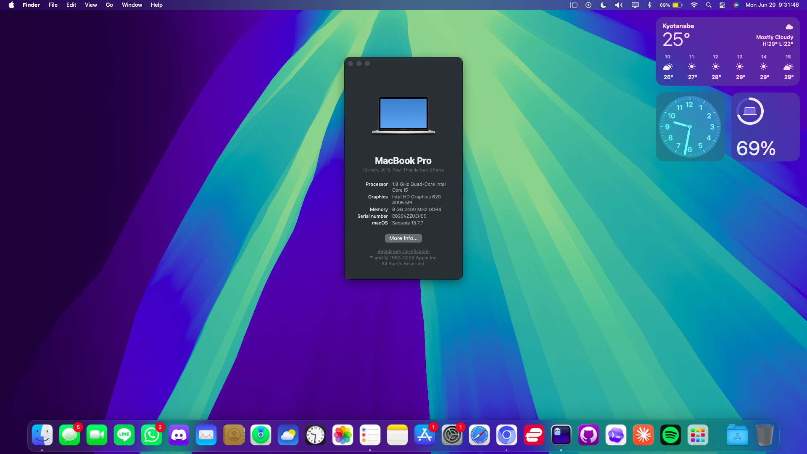

<div align="center">

<h1>A guide for installing macOS 15 on a ThinkPad T480</h1>

<h2>For the guide, I focus on bundling everything you need into one place, making it reproducible.</h2>

<p>A complete guide for installing <a href="https://apps.apple.com/us/app/macos-sequoia/id6596773750?mt=12">macOS</a> Sequoia on the <a href="https://www.lenovo.com/us/en/p/laptops/thinkpad/thinkpadt/thinkpad-t480/22tp2tt4800?srsltid=AfmBOooXFtlhLQXZFbJswnsfmBPZG1QH3bZPpnrvW3ITn5nMiqsZHqEH">ThinkPad T480</a> from start to finish using <a href="https://dortania.github.io/OpenCore-Install-Guide/">OpenCore</a> as the bootloader, including a guide for undervolting via <a href="https://github.com/sicreative/voltageshift">VoltageShift</a>, WiFi patching via <a href="https://github.com/laobamac/OCLP-Mod">OCLP Mod</a>.</p>



<br/>

[](https://www.apple.com/macos/macos-sequoia/)
[](https://dortania.github.io/OpenCore-Install-Guide/)
[](https://github.com/sicreative/voltageshift)
[](https://github.com/laobamac/OCLP-Mod)
[](LICENSE)

**This repo is made for educational purposes, and I do not condone the piracy of any Apple products.**

**I am not responsible for causing any harm to your devices; this guide is provided as is and should only be used at your own risk.**

**This guide was made for my ThinkPad T480 and is not guaranteed to work for your t480.**

**I just recently made a opencore EFI for running MacOS Tahoe on the ThinkPad t480, here is the link [tahoe-t480](https://github.com/tame-t/tahoe-t480)**

</div>

---

### Things You Need
1. A working ThinkPad T480.
2. A working Windows computer; this can be your ThinkPad too.
3. A 4GB USB drive. **You can use an SD card if you have an SD card to USB adapter, since the T480 SD card slot is not loaded in OpenCore's boot menu and in BIOS**.
4. Some time to get things working.

### Preferred
1. Ethernet connection, having a working Ethernet connection to will can make it so you can skip Ventura completely, installing sequoia for this Guild i will assume you don't have a ethernet connection, but include documentation for Ethernet users.
---

### My Specs

| T480      | Model |
|--|--|
| CPU       | Intel Core i5-8350U |
| GPU       | Integrated Intel UHD Graphics 620 |
| SSD       | NVMe SSD 256GB |
| Display   | 1080p panel |
| Memory    | 8GB DDR4 2400MHz tested for 16gb working |
| Camera    | Camera works on macOS |
| WiFi & BT | Intel Dual Band Wireless-AC 8265 |
| Keyboard  | Backlight Keyboard |

---

### What's Working, Not Working, or Not Tested

| Working | Not Working | Not Tested |
|--|--|--|
| Native WiFi 🛜 | Finger Print Reader 🫆 | Dual Booting 🥾 |
| Bluetooth 🔵 |AirDrop & Continuity 💨 | Simcard 📶 wwan |
| Find My 📱 (needs to be enable in settings)| Thunderbolt 3 ♆ | LAN Port 🌐 |
| Brightness ☀︎ & Volume Control 🎧 | Sidecar Wireless 🌐 ||
| Battery Information 🔋 |Apple Watch Unlock ⌚ ||
| Audio (Audio Jack & Speaker) 🔊
| Location services 🌍
| USB Ports 🔌 
| Built-in Camera 🎥
| Graphics Acceleration ▶️
| Trackpoint ➤
| Touchpad 🖱️
| Power management ⚡
| Sleep 💤
| FaceTime 👩🏻‍💻
| iMessage 💬
| HDMI 🖥️
| Automatic macOS updates 🔄
| Handoff 🫴
| Universal Clipboard 📋
| USB-C 🔌
| Undervotling 🪫
 
### Why use macOS
For me, I have an iPhone, and the Apple ecosystem is very well-rounded.
Everything works together: Universal Clipboard, my iMessages sync, my passwords sync, Find My iPhone or Mac.
They are really built for one another.

### Getting started
We are going to download this repo, which contains all the necessary files to be able to configure everything for your t480.

We are going to start by installing macOS Ventura, then upgrading to macOS Sequoia, applying the patches that fix airportltwm, and allowing native Wi-Fi connectivity with an Intel Wi-Fi card. Then we will add the Voltageshift to startup for undervolting.

Before we start backup any important files that you need.

First, we are going to configure the BIOS settings for OpenCore to function properly.

#### The BIOS settings:
-  `Security > Security Chip`: must be **Disabled**
-  `Memory Protection > Execution Prevention`: must be **Enabled**
-  `Virtualization > Intel Virtualization Technology`: must be **Enabled**
-  `Virtualization > Intel VT-d Feature`: must be **Enabled**
-  `Anti-Theft > Computrace -> Current Setting`: must be **Disabled**
-  `Secure Boot > Secure Boot`: must be **Disabled**
-  `Intel SGX -> Intel SGX Control`: must be **Disabled**
-  `Device Guard`: must be **Disabled**

#### In the Thunderbolt menu, set the following options:

-  `Thunderbolt BIOS Assist Mode`: **UEFI Only**
-  `Wake by Thunderbolt(TM) 3`: **No**
-  `Security Level`: **No**
-  `Support in Pre Boot Environment > Thunderbolt(TM) device`: **No**

#### In the Startup menu, set the following options:

-  `UEFI/Legacy Boot`: **UEFI Only**
-  `CSM Support`: **No**

The reason why we are installing macOS Ventura first is that macOS Sequoia patches the airportilwm.kext; the older version used to get wifi in recovery. 
If you have a working Ethernet connection you can use sequoia recovery instead, but for this guide, I will use Wi-Fi with inculcated guilds for Ethernet.

Unfortulatly I can't provide a .img or .iso file that is preconfigured because that is considered pricey and is very illegal.

#### Now we will prepare the USB for installing Ventura. 
The USB must be at least 4 GB for it to house the recovery images of macOS. We are going to be formatting the USB using Rufus, a Windows .exe application. The rufus.exe should already be in the
repository. [Rufus](https://rufus.ie/en/)

#### Now in Rufus
Select the USB that you're going to use and match all the selections with the image provided below, then hit Start.


After the USB is formatted, delete all files from the USB that came from the formatting. **Things like autorun** 

Then we are going to use macrecovery.py, which is located in the file you downloaded, to get the Ventura recovery files. If you have a working Ethernet connection get sequoia files instead [macosrecovery.py](https://github.com/acidanthera/OpenCorePkg/blob/master/Utilities/macrecovery/macrecovery.py)

This is a Python script, so you will need to install Python to use it,
Command for installing Python on Windows.

Run commands in windows power shell.

```bash
winget install -e --id Python.Python.3
```

Command for downloading macOS Ventura recovery files.

```bash
cd ~/Downloads/macos-15-t480/macrecovery
py macrecovery.py -b Mac-4B682C642B45593E -m 00000000000000000 download
```

Command for downloading macOS Sequoia recovery files.

```bash
cd ~/Downloads/macos-15-t480/macrecovery
py macrecovery.py -b Mac-937A206F2EE63C01 -m 00000000000000000 download
```

Now the recovery files are located at `~/Downloads/macos-15-t480/macrecovery/com.apple.recovery.boot/*`


And it should look something like this.

reboot and press enter and then F12 to get in to the boot picker it should look something like this.


Then select the usb/sd card or any drive that you use for opencore.

Now you in opencore, select the .dmg file to boot from, if the file doesn't show up for you try pressing space to show all hidden entries.
Now wait a bit, booting in to recovery can take a long time depending on you're drive speed "usb/sd card", after a bit it should start loading.


After a bit you will boot in to recovery, and look something like this.


Now you will have to connect to wifi to be able to install MacOS, on the top left Conner click the wifi icon and connect to wifi normal. 

If you have a working Ethernet connection and is booted in to sequoia wifi will not work with oclp patches, open the terminal and run ``` ping 1.1.1.1 ``` and ``` ping google.com ``` Ctrl + Z to suspend, you can also do this test if you are on wifi.

If it show something like this then its working, then exit out of terminal.
```bash
╭─ethan@Ethans-ThinkPad-Pro ~/Projects/macos-15-t480 ‹main›
╰─$ ping 1.1.1.1                                                                                                                                                                                             68 ↵
PING 1.1.1.1 (1.1.1.1): 56 data bytes
64 bytes from 1.1.1.1: icmp_seq=0 ttl=51 time=92.844 ms
64 bytes from 1.1.1.1: icmp_seq=1 ttl=51 time=62.844 ms
64 bytes from 1.1.1.1: icmp_seq=2 ttl=51 time=78.298 ms
64 bytes from 1.1.1.1: icmp_seq=3 ttl=51 time=66.376 ms
^Z
[2]  + 10628 suspended  ping 1.1.1.1
╭─ethan@Ethans-ThinkPad-Pro ~/Projects/macos-15-t480 ‹main›
╰─$ ping google.com                                                                                                                                                                                         146 ↵
PING google.com (142.251.118.101): 56 data bytes
64 bytes from 142.251.118.101: icmp_seq=0 ttl=107 time=80.705 ms
64 bytes from 142.251.118.101: icmp_seq=1 ttl=107 time=59.838 ms
64 bytes from 142.251.118.101: icmp_seq=2 ttl=107 time=55.608 ms
64 bytes from 142.251.118.101: icmp_seq=3 ttl=107 time=59.183 ms
^Z
[3]  + 10667 suspended  ping google.com
╭─ethan@Ethans-ThinkPad-Pro ~/Projects/macos-15-t480 ‹main›
╰─$                                                                                                                                                                                                         146 ↵
```

Now Select disk utility so we can format the drive.


Then from the menu bar or toolbar in Disk Utility, choose View > Show All Devices. *Note that those pictures of disk utility is from macos tahoe, you're s will look different but function the same.*


Then in the internal section select the drive you want to install MacOS on to. *You should be able to partition the drive here too but i wouldn't explain how to duel boot with one drive as its
uncharted territory for me, also i wound not recommend duel boot with a drive that is less then 500gb or installing on a HDD Hard Drive*.

Now select drive it self like show in the picture.


Now click Erase.


Now you can format the drive, for name you can name it anything you want for example hackintosh, macintosh, ssd, etc. Select APFS for format, and GUID Partition Map for scheme, then hit Erase.

*DISCLAIMER FORMATTING WILL ERASE ALL FILES AND CONTAIN ON THE DRIVE, PLEASE BACK UP ANYTHING YOU NEED BEFORE FORMATTING.*


Now you can exit out of disk utility, and select reinstall Ventura or Sequoia if you are on Ethernet.


